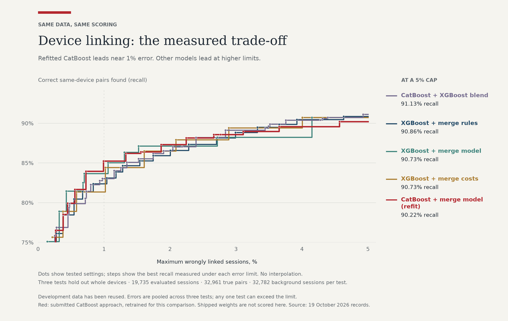

# Device ID linking

When someone visits a website, a session starts and a script collects signals about the visitor's
device: its hardware, its browser, its network. `sessions.parquet` (the same table as `sessions.csv.gz`) holds six
days of these sessions, and `data_dictionary.md` describes the signals.

The goal is to tell when two sessions come from the same device. This lets a site follow a user's behavior over
time, and it catches multi-accounting: one person creating many accounts to abuse a sign-up bonus or post spam.

Build a device ID system that links returning sessions using these signals. Maximize recall (how
often you link a session to the rest of its device) while keeping false positives (links to a different device)
low. Consider how a customer might want to balance the two, and why.

A device is one browser on one machine. Some sessions are labeled: `labeled_devices.json` lists their devices. The
rest are unlabeled, and **none of them belongs to a labeled device**. Assign a device ID to every unlabeled session.

`grade.py` scores a submission against a devices file, so you can check yourself on the labeled sessions:

    python grade.py submission.csv labeled_devices.json

## Submission contents

The submission contains:

- `submission.csv`, with the columns `session_id, device_id` and a row for every unlabeled session; sessions that
  share a `device_id` are one device;
- code with one command that takes a file of new unlabeled sessions in the format of `sessions.parquet` and
  an output path, and writes a submission there covering the unlabeled sessions here and the new ones, along
  with its runtime requirements.

An answer key is used to score both the submission and the command's output for unseen sessions.

## Review discussion

Be ready to walk through the work: what was considered, why this approach was chosen, how tools (including AI)
were used, and how the results were checked.

---

## Implemented solution

**We chose CatBoost + merge model.** One model scores pairs of sessions; a second checks whether whole groups
belong together. This is what produced `submission.csv` and what the command below runs, using `linker/model.joblib`.

### Run it

Use Python 3.12. It runs on CPU, needs no network access, and took about 35 seconds and 6 GB of RAM on our machine.

```bash
python3.12 -m venv .venv
.venv/bin/python -m pip install -r requirements.txt
.venv/bin/python linker/link.py NEW_SESSIONS.parquet OUTPUT.csv
```

- **Input.** New sessions in the format of `sessions.parquet`. Parquet, `.csv` and `.csv.gz` are all accepted.
- **Output.** `session_id,device_id` for every original unlabeled session plus every new session.
- **Known devices.** New sessions can join a known (labeled) device or an unlabeled one.
- **Certain links.** Sessions that share a `cookie_id` are always one device.
- **How cautious?** `--fpr-budget 1` aims to keep wrongly linked sessions around 1% and is the default.
  Use `0.5` for fewer risky links or `2` to recover more matches. These are targets, not guaranteed error rates.
- **Confidence.** `--confidence` adds `link_confidence`, an estimated link score. Its accuracy on new traffic
  hasn't been verified.
- **Checks.** Install `requirements-dev.txt`, then run `make check` for lint and tests. `make submission`
  rebuilds `submission.csv` byte for byte.

### What we tried

CatBoost and XGBoost learn from examples using many small decision trees. Each approach below first scores
pairs of sessions, then decides which groups to join. The difference is how it makes those decisions.

| Approach | How it works |
|---|---|
| **CatBoost + merge model — submitted** | CatBoost scores pairs. A second CatBoost model checks whole groups, with a rule that weighs recovered matches against sessions put at risk. |
| XGBoost + merge rules | XGBoost scores pairs. Fixed rules check the evidence between groups before joining them. |
| XGBoost + merge model | Uses the same XGBoost scores, then a second model (CatBoost) checks each proposed group merge. |
| XGBoost + merge costs | Uses XGBoost scores and weighs likely recovered matches against the number of sessions a bad merge would affect. |
| CatBoost + XGBoost blend | Combines both pair scorers, then applies the merge rules. The best 5% setting gives XGBoost more weight. |

A retrained version of the submitted approach led at the lower error limits. Other approaches found more
matches when allowed more mistakes. [The write-up](WRITEUP.md) has the details and links to each experiment.

### Results

We want to find as many real matches as possible while keeping mistakes low. **Recall** is the percentage of
same-device session pairs we put together. A session is **wrongly linked** if its group contains even one session
from another device. That includes a labeled session joined to any of the original unlabeled sessions.



Read the 1% column as: "How many real matches did we find while wrongly linking at most 1% of scored sessions?"
Each cell shows the best setting we tried under that limit. Bold numbers mark the highest recall in each column.

| Approach | ≤1% | ≤2% | ≤3% | ≤4% | ≤5% |
|---|---:|---:|---:|---:|---:|
| **CatBoost + merge model (refit)** | **85.25%** | **87.31%** | 88.57% | 89.58% | 90.22% |
| XGBoost + merge rules | 82.37% | 85.92% | 88.84% | **90.46%** | 90.86% |
| XGBoost + merge model | 83.67% | 87.13% | 88.25% | 88.25% | 90.73% |
| XGBoost + merge costs | 81.35% | 86.51% | **89.41%** | 89.41% | 90.73% |
| CatBoost + XGBoost blend | 83.04% | 86.54% | 89.14% | 90.38% | **91.13%** |

**“Refit” means we retrained the submitted approach for this comparison. These aren't scores for the saved
model the command runs.** We kept each device out of training while scoring it, using the same three groups
of devices and all 32,782 unlabeled background sessions for every approach. The limits apply to the combined
results; an individual group can exceed them. We've used these data before, so this isn't a fresh test.

We replaced the earlier chart after finding that its training and evaluation data weren't fully separated.
We haven't measured how much that affected its scores. See [how we checked the results](WRITEUP.md#3-evaluation-and-its-limits),
the [chart data](docs/frontier_data.json), or the [exact counts behind the table](docs/frontier_cap_winners.csv).

### How we got here

AI agents tried different signals, pair scorers and merging methods in separate branches. The biggest correction
was to count mistakes the way the grader does: one bad merge can spoil a whole group. We also audited which
devices each training step could see. [WRITEUP.md](WRITEUP.md) covers the experiments, mistakes and remaining gaps.

### Layout

| Path | What |
|---|---|
| `linker/` | The submitted system: `link.py` (the command), its modules, `model.joblib`, `confidence.json`, `test_link.py` |
| `research/` | Experiments and scripts to rebuild the charts |
| `docs/img/` | Charts used in this README and the write-up |
| `WRITEUP.md` | Method, evaluation protocol, everything we tried, and where it still fails |
