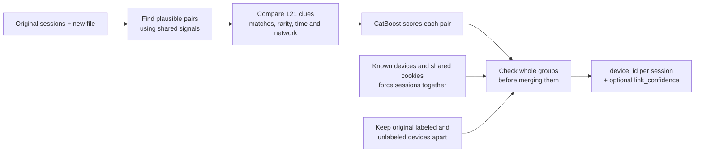
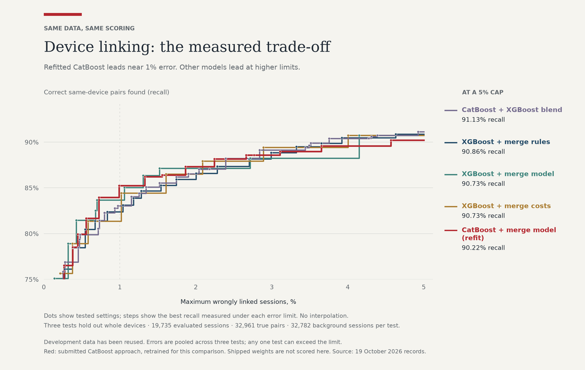
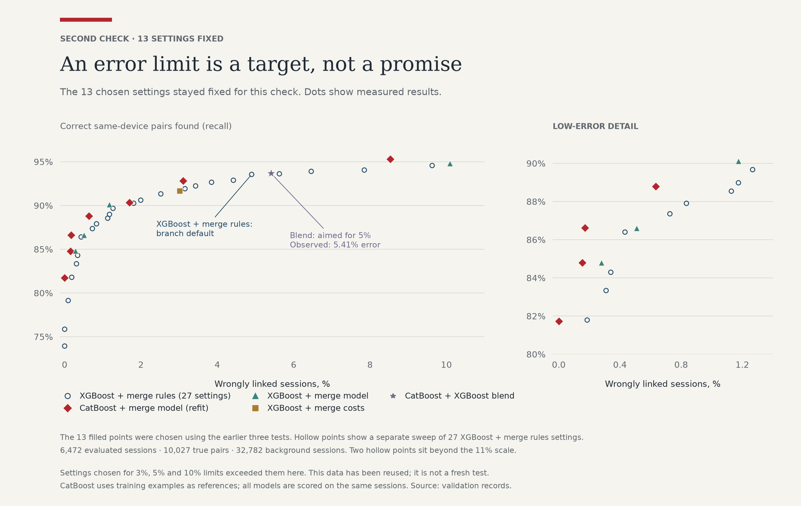
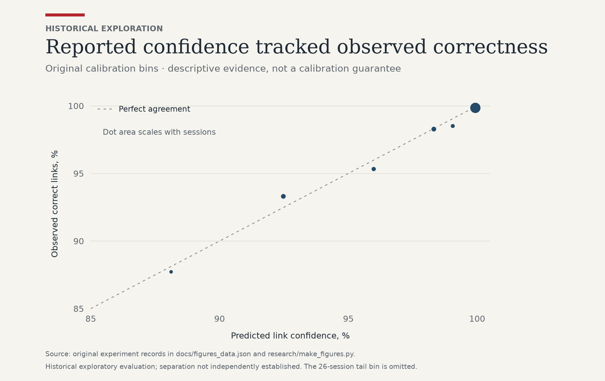
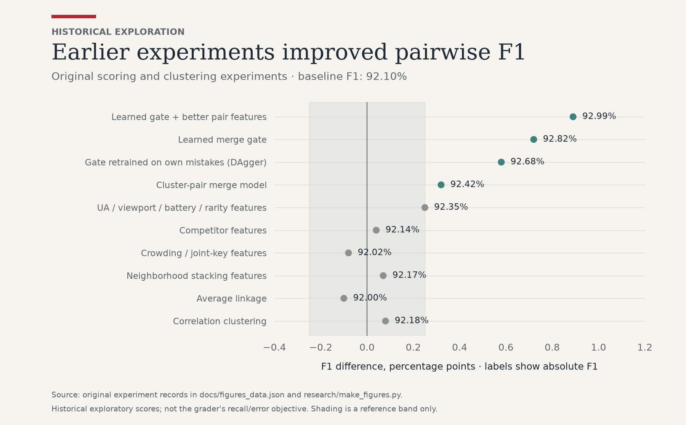
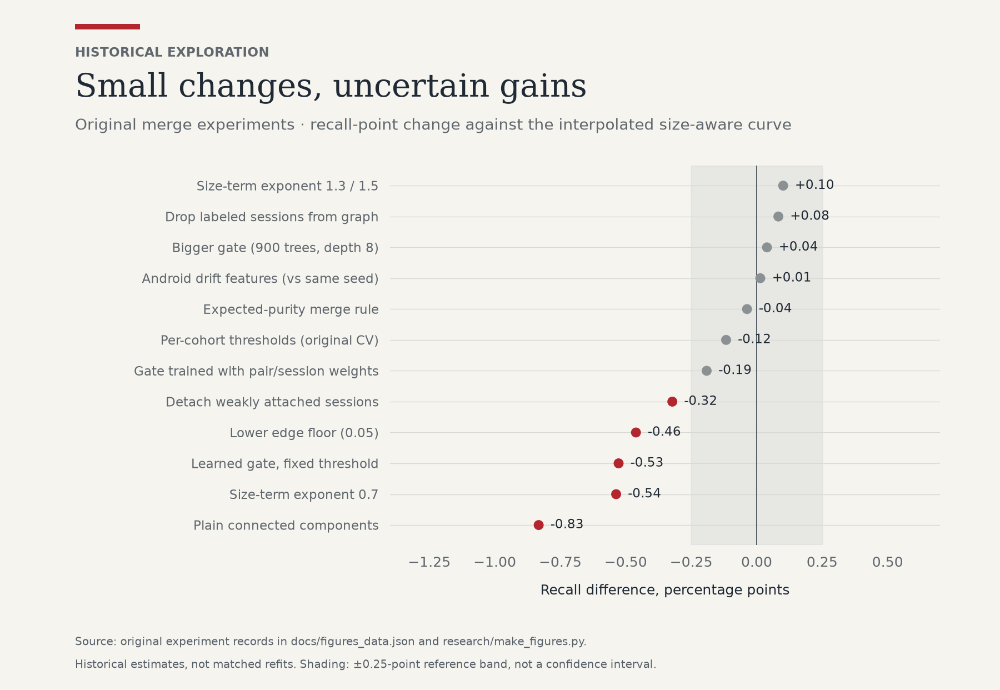
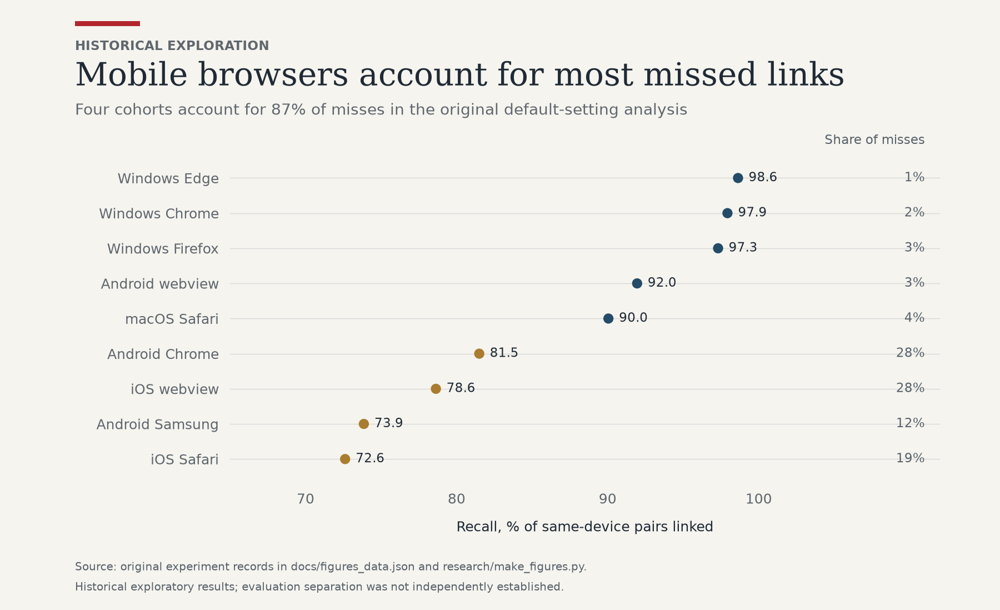
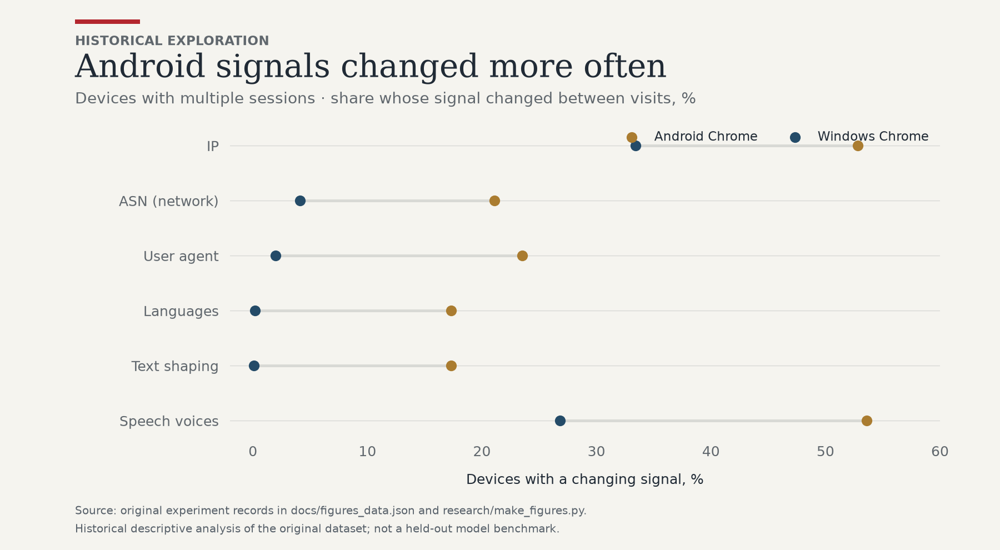
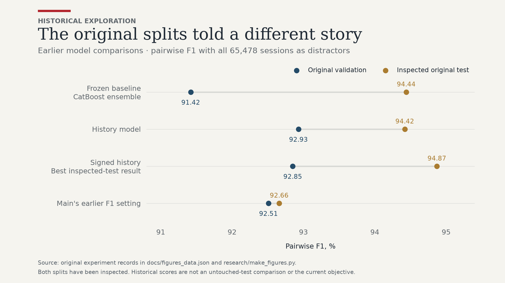
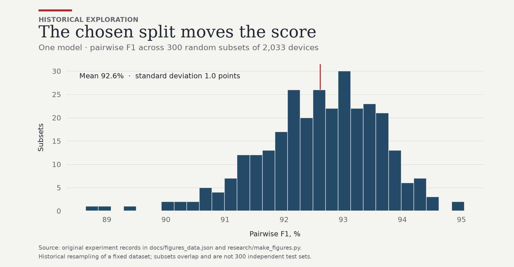

# Device linking: what we built and what we learned

**We chose CatBoost + merge model.** It scores pairs of sessions, then checks whether their whole groups belong
together. The command below runs that system using the saved model in `linker/model.joblib`.

In our later comparison, this approach found the most matches at the 1–2% error limits. Other approaches did
better when allowed more mistakes. We retrained the models for that comparison, so its scores aren't a report
card for the saved model. We also found problems in the original evaluation; section 3 explains what changed.

```bash
python3.12 -m venv .venv
.venv/bin/python -m pip install -r requirements.txt
.venv/bin/python linker/link.py NEW_SESSIONS.parquet OUTPUT.csv
```

## 1. The problem, and what "good" means

Each session has about 30 clues about its browser and device: hardware, fonts, rendering results, language,
timezone, network and battery. We need to decide which sessions came from the same browser on the same machine.
About 32k sessions have known devices; another 32.8k need device IDs.

`grade.py` reports two numbers, and they pull against each other:

- **Recall** is the share of same-device session pairs that we put together.
- **Wrongly linked sessions**, called false-positive rate in the grader, is the share of scored sessions grouped
  with *any* session from another device. Join two unrelated groups of 10 scored sessions, and all 20 count as wrong.

The goal is to find more real matches while keeping those mistakes low. Early on we optimized F1, a score that
balances missed and incorrect pairs. That was the wrong target: it can hide the damage a bad merge does to a
whole group. We now compare recall at several limits on wrongly linked sessions.

## 2. The pipeline

The submitted system works in six steps. The pair counts below come from the original run.



1. **Find plausible pairs.** Comparing every session with every other session is expensive. We first look for
   shared clues such as hardware plus network, fonts or audio output. There are 13 such rules; groups larger than
   400 sessions are skipped. This leaves 4.2 million candidate pairs and keeps 98.8% of the known true matches.
2. **Compare the clues.** We check what matches, what's missing, and how unusual a match is. A rare font list
   says more than “iPhone, English.” We also compare time gaps, battery changes, browser versions and networks.
3. **Score each pair.** CatBoost learns patterns from examples using many small decision trees. We average two
   models, each with 800 trees of depth 8. Known devices supply matching examples. The labeling rules also establish
   that original labeled and unlabeled sessions can't match, which supplies useful lookalike counterexamples.
4. **Check the whole group.** One convincing pair can accidentally join two unrelated devices. A second
   CatBoost model, the merge model or “gate,” checks both groups before joining them. It looks for supporting
   matches, conflicting times and networks, version changes and better matches elsewhere. Stronger pairs go first.
5. **Weigh the payoff against the risk.** Joining groups of sizes `a` and `b` can recover `a × b` true pairs or
   wrongly link `a + b` sessions. The rule uses those counts and the merge score `p`:
   `p ≥ 1 / (1 + k × a × b / (a + b))`. A larger `k` allows more merges; the command's presets choose `k`.
6. **Honor known links.** Sessions from one labeled device stay together, as do sessions sharing a cookie.
   Original unlabeled sessions stay separate from labeled devices. New sessions can join either kind.

## 3. Evaluation and its limits

### What the original evaluation got wrong

We found that some devices used for evaluation could also affect training. That makes the earlier scores less
trustworthy. The report had said both devices in each scored pair were kept out of training, along with a
separate 2,078-device test set. The code didn't fully enforce that:

- For devices in different evaluation groups, [`linker/cv.py`](linker/cv.py#L25-L41) averages two scores:
  one model excludes device A, the other excludes B. Each can still have trained on the other device.
- The merge model learns from those scores. Keeping an evaluation device out of its own training rows doesn't
  keep that device out of the pair models that supplied its examples.
- [`oracle_events`](linker/gate_run.py#L16-L39) treats the separate test sessions as unlabeled. Joining one to a
  training device becomes an “incorrect merge” example, allowing supposedly reserved test data into training.

We haven't measured how much these bugs affected the scores. The old **88.116% recall / 0.996% wrong sessions**
and “lockbox” **88.757% / 1.22%** results remain in the research record, but they aren't reliable scores on unseen
devices. The old chart also estimated roughly 92.5% recall at 5% error by drawing between measured points.
The best setting actually measured below that limit was 92.03% recall at 4.109% error.

Earlier experiments had also reused their test data while choosing models. We don't have an untouched test
result to report.

### The matched comparison

For the new comparison, we divided devices into three groups, often called **folds**. We trained on two groups
and scored the third, then rotated. Every scored device stayed out of all training steps, including those used
to build examples for the merge model.

That covers **19,735 scored sessions and 32,961 true pairs**. Every run also includes all **32,782 original
unlabeled sessions** as background. Joining one to a scored device counts as an error. Background sessions don't
inflate the denominator and make the error rate look smaller.

The CatBoost refit follows the submitted recipe, with fixes for consistent feature encoding, times
and pair ordering. It uses training sessions as reference points internally; the XGBoost approaches leave those
rows out. Both return the same scored session IDs. The shipped CatBoost model trained on all labeled devices,
so scoring it on these same devices wouldn't be a fair comparison.

For each setting, we add up correct pairs and wrong sessions across all three groups. We then pick the best
recall under each error limit. One setting must cover all three groups; we don't mix winners from different
groups or invent points between measurements. This is what “pooled” means in the chart data.

These are still data we've used before, and the background is shared across runs. Small differences might not
hold up on new traffic. We also added three lower-error CatBoost settings after seeing the first group's results,
then ran them on all three groups.

We checked the final groups against `grade.py` and checked which devices each training step could see. The new
[chart data](docs/frontier_data.json) stays separate from the [historical results](docs/figures_data.json).

## 4. The approaches and their results

Each approach has two jobs: score pairs, then decide which groups to join. CatBoost and XGBoost are both models
that learn from examples using decision trees. “Merge model” means a second learned check of the whole group.

| Approach | Techniques and idea |
|---|---|
| **CatBoost + merge model — submitted** | Two CatBoost pair scorers plus a CatBoost merge model. The final rule weighs recovered pairs against sessions put at risk. |
| XGBoost + merge rules | An XGBoost pair scorer trained to pay more attention to costly mistakes. Fixed rules check the average evidence between groups and limit group size. |
| XGBoost + merge model | The same XGBoost pair scores, followed by a CatBoost merge model. It checks group sizes, agreement, timing and conflicting signals. |
| XGBoost + merge costs | XGBoost pair scores with a rule that weighs likely recovered pairs against wrongly linked sessions. This version has no second learned model. |
| CatBoost + XGBoost blend | Combines both pair scorers, then uses the merge rules. Its 5% winner uses a geometric blend weighted 25% CatBoost and 75% XGBoost. |

**CatBoost + merge model is the approach we ship.** Its retrained version leads at the 1% and 2% limits below.
The experiments give us useful alternatives at higher limits, but no approach wins everywhere.



| Approach | ≤1% | ≤2% | ≤3% | ≤4% | ≤5% |
|---|---:|---:|---:|---:|---:|
| **CatBoost + merge model (refit)** | **85.25%** | **87.31%** | 88.57% | 89.58% | 90.22% |
| XGBoost + merge rules | 82.37% | 85.92% | 88.84% | **90.46%** | 90.86% |
| XGBoost + merge model | 83.67% | 87.13% | 88.25% | 88.25% | 90.73% |
| XGBoost + merge costs | 81.35% | 86.51% | **89.41%** | 89.41% | 90.73% |
| CatBoost + XGBoost blend | 83.04% | 86.54% | 89.14% | 90.38% | **91.13%** |

Each cell is the best recall we measured under that column's limit on wrong sessions. Bold numbers mark the
column leaders; small differences aren't proof that one approach will do better on new data. **Refit means
retrained for this comparison, not the saved model used by the run command.**

The limits apply after combining the three runs. For example, the CatBoost 1% winner has 0.988% error overall
but 1.206% in its hardest group. If **every group must stay below 1%**, recall is 83.95% for CatBoost + merge model,
83.67% for XGBoost + merge model, and 82.37% for XGBoost + merge rules. The blend's 5% winner reaches 5.54% in
its hardest group.

### Trying the chosen settings on another batch

We chose 13 settings from the comparison before running them on another batch: 6,472 scored sessions,
10,027 true pairs and all 32,782 background sessions. We didn't change those settings after seeing the results.
This batch had been used in earlier work, so it still isn't a fresh test.



The CatBoost setting chosen for 1% error reached **86.63% recall / 0.17% wrong sessions**. XGBoost + merge model's
1% choice reached **86.60% / 0.51%**. Some choices missed their targets: XGBoost + merge costs selected for 3%
reached **91.66% / 3.01%**, the blend selected for 5% reached **93.67% / 5.41%**, and XGBoost + merge model selected
for 10% reached **94.82% / 10.09%**. A limit met on one batch isn't a promise about the next.

The [chart data](docs/frontier_data.json) records the comparison results. A separate sweep of 27 settings for
the saved XGBoost + merge rules model is not included in this snapshot.

## 5. Choosing how cautious to be

A wrong link can attach someone's activity to another user. A missed link makes a returning device look new.
Which is worse depends on the customer, so we show the tradeoff rather than just one score.

`--fpr-budget 1` is the default and aims for around 1% wrongly linked sessions. Use `0.5` to be more cautious or
`2` to find more matches while accepting more risk. These presets came from the original evaluation, so their
names are targets, not verified limits on new traffic. The later refit didn't replace the saved model or presets.

`--confidence` adds `link_confidence`, a score intended to estimate whether a session's group contains only its
own device. The mapping from score to confidence came from the original evaluation:



Because of the evaluation bugs, a score of 0.99 hasn't been shown to mean 99% correct on new traffic. We'd check
it on fresh data before using it to make automatic blocking decisions.

## 6. Historical experiments

These tables keep a record of what we tried before the comparison above. They use different datasets and scoring
setups, including the evaluation with the bugs described in section 3. “CV” means repeated training and scoring
on different groups of devices. “Kept” means the technique is in the submitted system.

### Pair scorers and features

| Tried | Result | Kept? |
|---|---|---|
| Hand-weighted rules (rare matches count more) | 85.9 F1 (earlier round, small-population benchmark) | No |
| Naive Bayes / Fellegi–Sunter (the classic record-linkage model) | 76.2–83.0 F1 (same benchmark) | No |
| **XGBoost** pair model | 95.7 (96.7 with hard negatives) vs CatBoost's 96.5 (97.1) on the same benchmark | No |
| **CatBoost** pair model | selected by the original experiments | **Yes** |
| CatBoost + XGBoost blend | 92.77 F1 full-pop validation, 94.11 test; no gain | No |
| Per-browser "expert" models (earlier round) | 89.7–91.2 F1 vs 91.7 for the global model | No |
| Hard negatives: labeled vs unlabeled lookalikes | +2.6 to +3.9 F1 (earlier round, full-population validation) | **Yes** |
| Seed averaging | removes ±0.25 of run-to-run noise | **Yes** |
| UA / viewport / battery / whole-fingerprint rarity, neighborhood stacking, crowding counts, competitor features | all within ±0.25 of baseline | Partly (rarity) |
| Android drift features (plausible ASN/UA/language transitions) | +0.01 at equal FPR | No |

The original run skipped LightGBM because its macOS setup was missing `libomp`, a threading dependency.
CatBoost worked in that environment, so the experiments continued with it.



### Clustering and merging

| Tried | Result | Kept? |
|---|---|---|
| Connected components at a threshold | the baseline, 92.10 CV F1 | Replaced |
| Average linkage | 92.00 | No |
| Correlation clustering / signed-graph optimization (both rounds) | 92.18; "97.5" in the earlier round was only on a smaller, easier population | No |
| Leiden community detection, 64 configurations (earlier round) | 91.35 F1 full-pop validation | No |
| Learned history / group-merge models, 860 features (earlier round) | 92.93 val / 94.42 test | Superseded by the gate |
| **Learned merge gate (Kruskal + CatBoost on cluster evidence)** | **92.82**, **92.99** with better pair features | **Yes** |
| Gate retrained on its own mistakes (DAgger) | 92.68 | No |
| **Size-aware acceptance rule** | +0.5–0.9 recall at equal FPR | **Yes** |



Other ideas didn't help in those runs:

- **About the same:** a bigger merge model, different ways of weighting group size and predicted mistakes,
  separate cutoffs for browser groups, and leaving labeled sessions out of the graph.
- **Worse:** removing weakly attached sessions afterwards and letting weaker pair scores propose merges.

### Time-series signals

Sessions span six days, so time matters:

- **Pair features:** the gap between sessions; battery level change and its rate per hour, given the charging flag;
  and whether browser and OS versions go up (normal) or down (suspicious).
- **Gate features:** nearly simultaneous sessions on different networks, and version downgrades a merge would create.

The earlier round also tried:

- **Chronological replay** (only use the past): 94.45 test F1, about the same as batch.
- **A 10-minute cookie veto:** fell to 81.6 F1, because devices legitimately rotate cookies quickly.

Time is useful as evidence, but rules built on it were too blunt.

### IP linkage

| Fact (labeled data) | Value |
|---|---|
| True same-device pairs that share an exact IP | 56% |
| P(same device \| share IP) | 87.6% |
| P(same device \| share IP + same hardware/UA) | **99.8%** |
| Missed pairs (at the 1% setting) that share an IP | **47 of 5,232** |

About 99% of the remaining misses in that run involved different IP addresses, as you'd see when moving between
home Wi-Fi, mobile data and an office. The model already compares exact IPs, network ranges and providers.
Finding matches across those changes is still worth exploring.

## 7. Historical error analysis

These charts show the original results by browser and device type. We haven't rerun this breakdown using the
corrected evaluation, so the accuracy numbers carry the same caveat as the other historical results.



The original analysis reported 97–99% desktop recall with under 0.5% wrongly linked sessions. Most missed
matches were on mobile, where we saw two recurring problems:

- **Many iPhones look alike.** In these data, 42% of iOS Safari sessions share their full fingerprint with at
  least 10 others. One 26-session device split into a “home IP” half and a “work IP” half, among 775 sessions with
  the same fingerprint. The fingerprint alone doesn't give us much to go on.
- **Android fingerprints change.** A returning phone can look different after an update or settings change.

  

  We saw network changes alongside changes in browser version, desktop mode, language, text rendering or
  downloaded voices. The model has to distinguish a returning phone with new settings from another similar phone.

Features describing nearby matches, common fingerprints and plausible changes didn't clearly help in the
original runs. That doesn't mean we've reached the best possible score. Longer histories and more reliable
identifiers are reasonable next things to try.

## 8. Relation to earlier rounds



We kept these older comparisons to show the research history. Their validation and test batches were used
repeatedly while choosing models, so the results aren't a fresh check of performance. The chart below also shows
how much the score changes when different devices land in each batch.



The newer comparison uses the same devices for every approach and checks the final groups with the grader.
It gives us a better comparison of the methods we've tried, while leaving their performance on fresh traffic
an open question.

The experimental model implementations used separate branches and are not included in this snapshot. The
submitted CatBoost + merge model and the committed aggregate results are included here.

## 9. Engineering notes

- **Speed.** Calling CatBoost once for each proposed merge was slow: a run took over 10 minutes.
  `linker/fastgate.py` evaluates the same trees in NumPy, matching CatBoost to 1e-16. The original timing after
  that change was about 35 seconds and 6 GB RAM; it depends on the machine and input size.
- **Reproducibility.** A clean clone with a plain `venv` and `pip install -r requirements.txt` reproduces
  `submission.csv` byte for byte.
- **Tests.** Install `requirements-dev.txt` and run `make check` for lint, type checks and nine tests. Six in
  `linker/test_link.py` run the command end to end and check:

  - every unlabeled session appears exactly once, and no labeled one;
  - a shared cookie forces one device;
  - a labeled device's cookie pulls new sessions onto that device;
  - no original unlabeled session ever lands on a labeled device;
  - `--confidence` adds the column without changing the grouping;
  - no new rows are dropped.

  The other three check the chart's error limits and device-group counts.

- **Figures.** Run `.venv/bin/python research/make_figures.py` to rebuild every chart from committed aggregate
  counts; no raw sessions or model training are needed. The comparison figures use `docs/frontier_data.json`,
  `research/frontier_charts.py` and the shared `research/chart_style.py`. They also export SVGs and exact cap
  results in `docs/frontier_cap_winners.csv`. Historical data stay separate in `docs/figures_data.json`.
  The original experiment scripts are `build_pairs.py` (pairs and features), `run_cv.py` (original CV
  scores), `opt.py` (operating points), and `figures_data.py` + `make_figures.py` (historical charts). Earlier
  round code and some pruned experiment implementations are not included in this snapshot. One of the three
  seed runs averaged into the original CV scores used neighborhood-stacking features from that earlier work.

## 10. How AI was used

AI coding agents wrote and tested the models under human direction. Codex explored pair scorers and device
history; Claude Code built the submitted CatBoost system with agents working on features, merging and error
analysis. Labels and cookies weren't learned features. They did supply known links and training examples.

The experiments had mistakes: early work kept checking its test set, and the submitted system's evaluation
didn't fully keep scored devices out of training. A later Codex run audited those boundaries and compared the
five approaches on the same devices. Those are the results in section 4.

Human review caught the mismatch with the grader, clarified that labeled-to-unlabeled merges count as wrong,
and prompted the evaluation audit. Passing code tests and getting a good score weren't enough: we also had to
check what the models were allowed to see.
